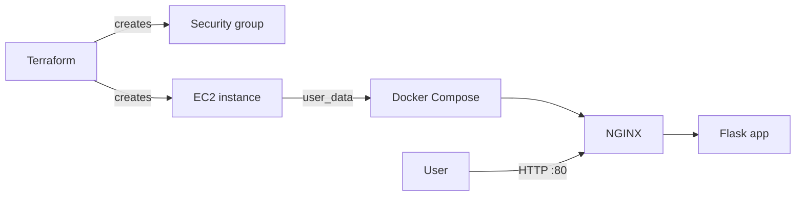

# terraform-aws-ec2-docker

**Goal:** Provision an AWS EC2 server and security group with Terraform, and automatically deploy a Dockerized Flask app behind NGINX on first boot.

## Tools used

- Terraform
- AWS EC2 and security groups
- Docker Compose and NGINX
- cloud-init (`user_data`)

## Architecture



## Project structure

```
.
├── main.tf                    # EC2 instance, security group, AMI lookup
├── variables.tf               # inputs (region, instance type, key name, my IP)
├── outputs.tf                 # public IP and app URL
├── user_data.sh               # boot script: installs Docker and starts the stack
├── terraform.tfvars.example   # example values
└── docs/                      # screenshots
```

## Usage

1. Install Terraform and the AWS CLI, then run `aws configure` with an IAM user's credentials.
2. Copy the example variables and fill in your values:
   ```bash
   cp terraform.tfvars.example terraform.tfvars
   ```
   - `my_ip`: your public IP in CIDR form, e.g. `203.0.113.10/32`
   - `key_name`: the name of an existing EC2 key pair
3. Deploy:
   ```bash
   terraform init
   terraform plan
   terraform apply
   ```
4. Open the `app_url` output in a browser (allow 2 to 3 minutes for first boot).
5. Clean up:
   ```bash
   terraform destroy
   ```

## What gets created

| Resource | Purpose |
|---|---|
| `aws_security_group` | SSH from my IP only, HTTP open to the world |
| `aws_instance` | Ubuntu 24.04 server, IMDSv2 enforced, 8 GB gp3 disk |

## How it works

On first boot, `user_data.sh` installs Docker, clones the [aws-ec2-nginx-deploy](https://github.com/jashwanthreddy123/aws-ec2-nginx-deploy) repo and runs `docker compose up -d`. The result is an NGINX reverse proxy in front of the Flask app image published in [docker-cicd-demo](https://github.com/jashwanthreddy123/docker-cicd-demo).

## Screenshots

### Terraform apply


### App in browser


### EC2 console


## Notes

- `terraform.tfvars`, state files and key files are git-ignored.
- SSH is limited to my IP, and the instance enforces IMDSv2.
- Run `terraform destroy` when finished to avoid charges.

## What I learned

- Describing cloud infrastructure as code with Terraform
- Looking up the latest Ubuntu AMI with a data source
- Bootstrapping a server with `user_data`
- Keeping secrets and state out of Git
